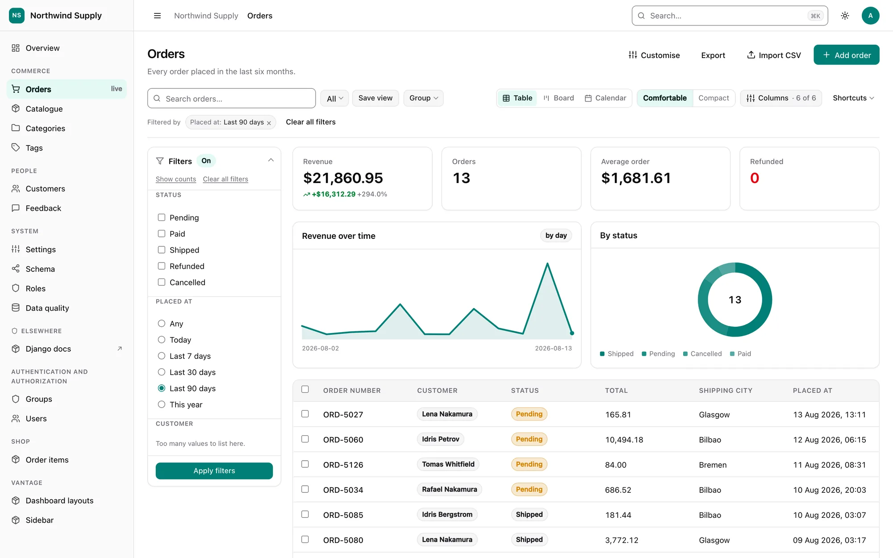
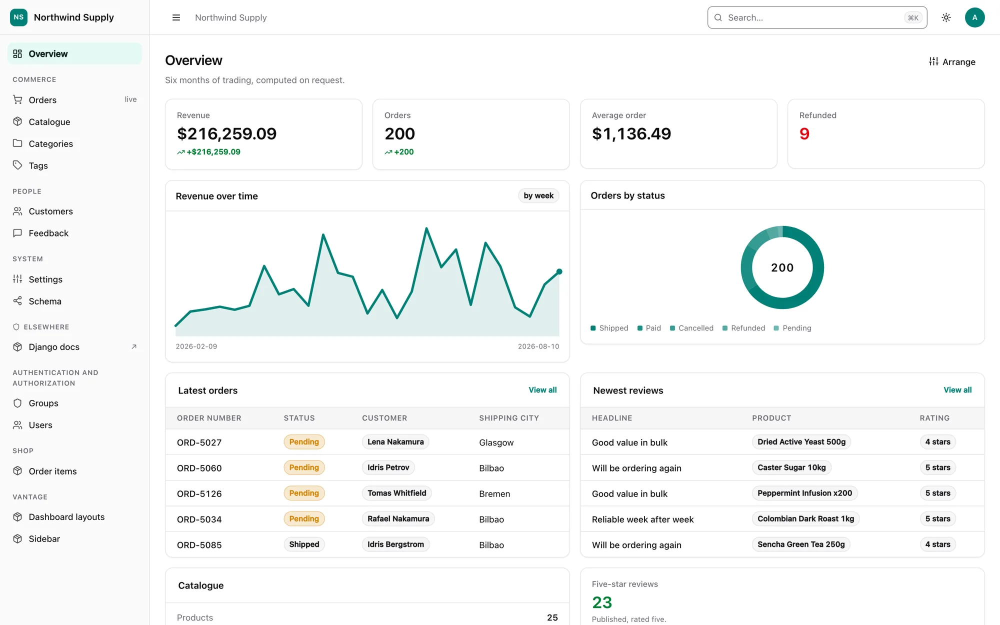
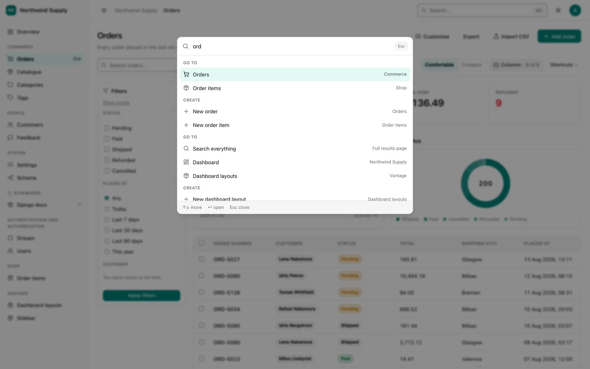
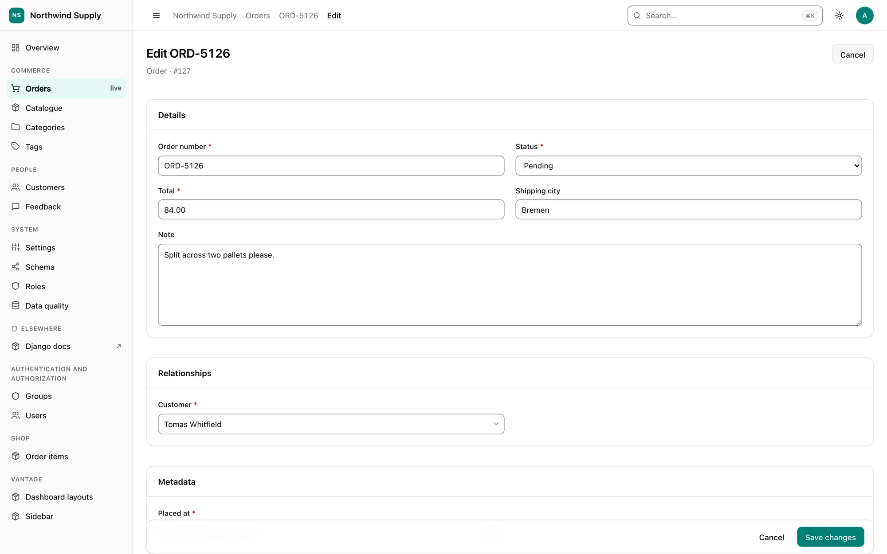
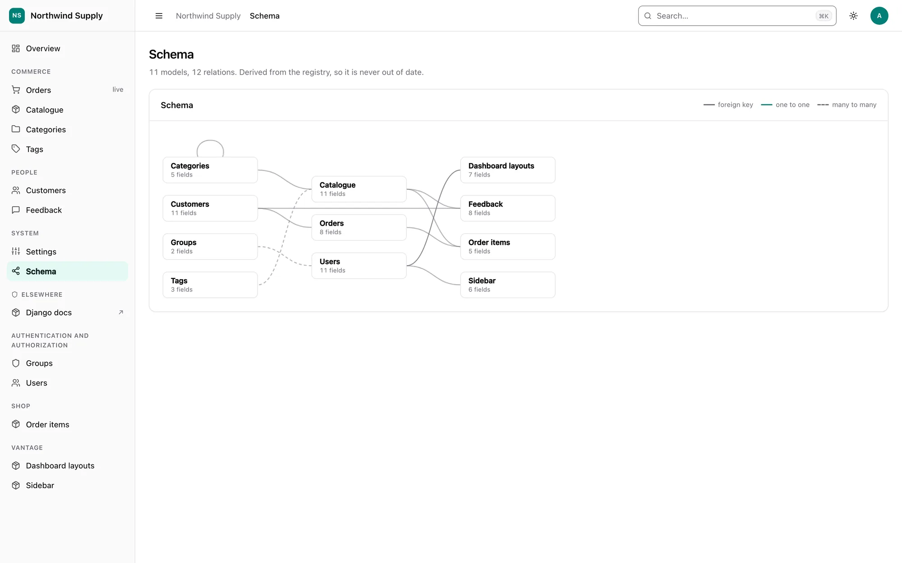

<div align="center">

<a href="https://pythondeveloper6.github.io/django-vantage/">
  <picture>
    <source media="(prefers-color-scheme: dark)" srcset="docs/assets/logo-dark.svg">
    
  </picture>
</a>

**A smart, beautiful admin panel for Django.**<br>
Zero config to start. One line to override anything.

[](https://pypi.org/project/django-vantage/)
[](https://pypi.org/project/django-vantage/)
[](https://pypi.org/project/django-vantage/)
[](https://github.com/Pythondeveloper6/django-vantage/actions/workflows/ci.yml)
[](https://github.com/Pythondeveloper6/django-vantage/blob/main/LICENSE)

[**Documentation**](https://pythondeveloper6.github.io/django-vantage/) ·
[Getting started](https://pythondeveloper6.github.io/django-vantage/getting-started/) ·
[Changelog](https://github.com/Pythondeveloper6/django-vantage/blob/main/CHANGELOG.md) ·
[FAQ](https://pythondeveloper6.github.io/django-vantage/faq/)

</div>

<picture>
  <source media="(prefers-color-scheme: dark)" srcset="docs/assets/screenshots/orders-dark.webp">
  
</picture>

> **Alpha (`0.1.0a1`).** Working and heavily tested — more than 3,600 tests — but the
> API may still move. See the
> [FAQ](https://pythondeveloper6.github.io/django-vantage/faq/#how-finished-is-this)
> for an honest account of what is and is not done. Use it on an internal tool, and
> pin the exact version if you depend on it.

## Why

Django's built-in admin is remarkable for what it is, and it hasn't fundamentally changed in
twenty years. `django-vantage` keeps what made it great — configuration in ordinary Python, next
to your models — and rebuilds everything else: the rendering, the data grid, the relationship
handling, and the look.

Two rules govern the whole package:

1. **Smart.** Install it, and every model in your project already has a good admin — columns,
   filters, search, widgets, and query optimisation inferred automatically.
2. **Easy.** Every inferred default is overridable in one line. If it takes more, the API is wrong.

## Install

```bash
pip install --pre django-vantage
```

`--pre` is needed while Vantage is in alpha, because pip skips pre-releases unless asked.

```python
# settings.py
INSTALLED_APPS = ["vantage", ...]

# urls.py
from django.urls import path
from vantage import site

urlpatterns = [path("admin/", site.urls)]
```

That is the entire setup. Every model is now administrable, with a dashboard, a searchable
data grid, create/edit/delete, a command palette, light and dark themes, and a schema map.

## Customise a model

Create `panel.py` next to your `models.py`:

```python
from vantage import ModelPanel, register
from blog.models import Post

@register(Post)
class PostPanel(ModelPanel):
    list_display = ["title", "author", "status", "published_at"]
```

Overriding `list_display` overrides *only* the columns. Filters, search fields and widgets stay
inferred. Partial configuration never opts you out of the intelligence.

Not sure what it inferred? Ask it to write it down:

```bash
python manage.py vantage_scaffold blog
```

That prints a real `panel.py` containing exactly what Vantage decided, which you can then own
and edit. Delete an attribute and it goes back to being inferred.

## Statistics and charts on any list page

Declared in Python, computed against the currently filtered queryset, no JavaScript:

```python
from vantage import Chart, ModelPanel, Stat, register
from django.db.models import Avg, Count, Q, Sum

@register(Order)
class OrderPanel(ModelPanel):
    list_filter = ["status", "created_at"]

    list_stats = [
        Stat("Revenue",   Sum("total"), format="currency", trend="created_at"),
        Stat("Orders",    Count("id")),
        Stat("Avg order", Avg("total"), format="currency"),
        Stat("Refunded",  Count("id", filter=Q(status="refunded")), tone="destructive"),
    ]
    list_charts = [
        Chart.timeseries("Revenue over time", date="created_at", value=Sum("total")),
        Chart.breakdown("By status", group_by="status", value=Count("id"), kind="donut"),
    ]
```

Change a filter and every number follows. Filter to the last 90 days and `Revenue` compares
itself with the 90 days before. All four stats fold into one shared `aggregate()` call, plus
one more for the trend window — two queries total, however many non-trending stats you add.
The charts render as inline SVG that follows your brand colour and the current theme.

There is also a per-column summary bar at the foot of every table, which needs no configuration
at all — a money column is summed, a rating column is averaged, and an identifier is left alone.

<table>
  <tr>
    <td width="50%">
      <picture>
        <source media="(prefers-color-scheme: dark)" srcset="docs/assets/screenshots/dashboard-dark.webp">
        
      </picture>
      <p align="center"><b>Dashboard</b> — widgets declared in Python or arranged from the UI</p>
    </td>
    <td width="50%">
      <picture>
        <source media="(prefers-color-scheme: dark)" srcset="docs/assets/screenshots/palette-dark.webp">
        
      </picture>
      <p align="center"><b>Command palette</b> — <kbd>⌘</kbd> <kbd>K</kbd> to go anywhere</p>
    </td>
  </tr>
  <tr>
    <td width="50%">
      <picture>
        <source media="(prefers-color-scheme: dark)" srcset="docs/assets/screenshots/order-form-dark.webp">
        
      </picture>
      <p align="center"><b>Forms</b> — inferred widgets and sections, or your own layout</p>
    </td>
    <td width="50%">
      <picture>
        <source media="(prefers-color-scheme: dark)" srcset="docs/assets/screenshots/schema-dark.webp">
        
      </picture>
      <p align="center"><b>Schema map</b> — derived from the registry, never out of date</p>
    </td>
  </tr>
</table>

## Bulk actions

Ordinary methods with a decorator:

```python
from vantage import ModelPanel, action, register

@register(Review)
class ReviewPanel(ModelPanel):
    @action("Publish", icon="check")
    def publish(self, request, queryset):
        return f"Published {queryset.update(is_published=True)} reviews."

    @action("Delete", destructive=True, permission="delete", max_rows=500,
            confirm="Permanently delete {count} reviews?")
    def delete_selected(self, request, queryset):
        deleted, _ = queryset.delete()
        return f"Deleted {deleted} records."
```

"Select all matching" travels as a predicate plus an exclusion set, never as a list of ids, so
selecting forty thousand rows costs the same as selecting three. The scope actually resolved is
always reported back — a bulk action must never quietly apply to less than you asked for.

## Lay out a form

```python
from vantage import Row, Section, Tab, Tabs

layout = Tabs(
    Tab("Content", Section(Row("title", "slug"), "body")),
    Tab("SEO", Section("meta_title", "meta_description")),
)
```

A field the layout forgets is appended rather than dropped, and a field it names that does not
exist fails `manage.py check` rather than silently vanishing from the form.

## Brand it

```python
VANTAGE = {
    "SITE_TITLE":  "Acme",
    "LOGO":        "img/acme.svg",
    "BRAND_COLOR": "#0ea5e9",
    "THEME":       "system",
}
```

One colour produces a complete palette for both themes, with contrast checked: the derived
primary and its foreground are guaranteed to clear WCAG AA for any hue you supply.

Anything here can also be edited **in the panel** by a superuser — logo upload, brand colour,
title, theme — and the database value overrides the file.

## Organise the sidebar

```python
VANTAGE = {
    "NAV": [
        {"route": "vantage:dashboard", "label": "Overview", "icon": "layout-dashboard"},
        {"group": "Commerce", "items": [
            {"model": "shop.Order", "badge": "live"},
            {"model": "shop.Product", "label": "Catalogue"},
        ]},
        {"group": "Elsewhere", "items": [
            {"url": "https://status.example.com", "label": "Status"},
        ]},
    ],
}
```

Declaring a nav can reorder, rename and hide — it can never grant access. Every entry still
passes through the permission layer.

## Add your own page

```python
from vantage import Page, site

@site.register_page
class RevenuePage(Page):
    title = "Revenue"
    icon  = "trending-up"

    def get_context(self, request):
        return {"total": Order.objects.total_revenue()}
```

A class, a title, and a method. The URL, the nav entry and the rendering all have defaults, so a
page with no template of its own still produces a presentable screen.

## Configure it from the UI too

Everything above is the developer's API. The person running the panel day to day can
often reach the same knobs without a deploy: a list's columns, filters, stats and
charts have a customisation rail, the dashboard has its own "Add a card" editor, and
branding and behaviour have a settings screen. All of it composes in one fixed
order — **UI override → `panel.py` / `VANTAGE` → inference** — stated once in
[How configuration resolves](https://pythondeveloper6.github.io/django-vantage/configuration/),
so "why is my `panel.py` being ignored?" has a single, findable answer.

## What else is in the box

| | |
|---|---|
| **JSON API** | Every panel, through the same permission and validation path as the UI — cursor pagination, optimistic concurrency, errors as structured data. [Docs →](https://pythondeveloper6.github.io/django-vantage/api/) |
| **Command palette** | <kbd>⌘</kbd> <kbd>K</kbd> with global search across every model you can see |
| **Dashboard** | Widgets declared in Python, or built and arranged from the UI — stat, chart, table, list, or your own template |
| **Soft delete** | A real Trash tab and Restore on any model with a `deleted_at` or `is_deleted` column, detected automatically |
| **Duplicate and bulk edit** | Both reuse the exact form and validation a single record uses |
| **Multi-tenancy** | Scope every registered model to a tenant with one setting, fail-closed. [Docs →](https://pythondeveloper6.github.io/django-vantage/tenancy/) |
| **Cascade-delete preview** | The real tree of what a delete takes with it, counted |
| **Read-only mode, impersonation** | Both enforced in the permission layer |
| **System health page** | Migrations, cache, database, task backend |
| **Streaming CSV export, CSV import** | Export honours the filters and sort you are looking at; import maps, previews and validates first |
| **Light, dark and system themes, RTL** | All from day one, with `en` and `ar` catalogues shipped |
| **Query-count guarantees** | `select_related` and `prefetch_related` are derived from what the page renders, and tests assert the cost does not grow with the row count |

## Requirements

Python 3.12, 3.13, 3.14 · Django 5.2 LTS, 6.0, 6.1

Django is the only runtime dependency. No Node.js — assets ship prebuilt.
django-guardian, django-rules and django-simple-history are used if present, never required.

## Try the demo

A full demo shop lives in [`example/`](https://github.com/Pythondeveloper6/django-vantage/tree/main/example):

```bash
git clone https://github.com/Pythondeveloper6/django-vantage
cd django-vantage
uv sync --all-groups
./example/run.sh          # migrate, seed, and serve on :8765
```

Sign in as `admin` / `admin12345`.

## Contributing

Contributions are welcome — bug reports, docs fixes and pull requests alike. Start with
[CONTRIBUTING.md](https://github.com/Pythondeveloper6/django-vantage/blob/main/CONTRIBUTING.md),
and please report security issues privately as described in
[SECURITY.md](https://github.com/Pythondeveloper6/django-vantage/blob/main/SECURITY.md).

```bash
uv sync --all-groups
uv run pytest
uv run ruff check src tests
uv run mkdocs serve       # the documentation site, on :8000
```

## Licence

django-vantage is open source under the
[MIT licence](https://github.com/Pythondeveloper6/django-vantage/blob/main/LICENSE).
Copyright © 2026 Mahmoud Ahmed.

You may use, modify and redistribute it, commercially or not, as long as the copyright notice
and the licence text are kept in every copy or substantial portion of the code. If
django-vantage helps your project, a link back to this repository is always appreciated.
