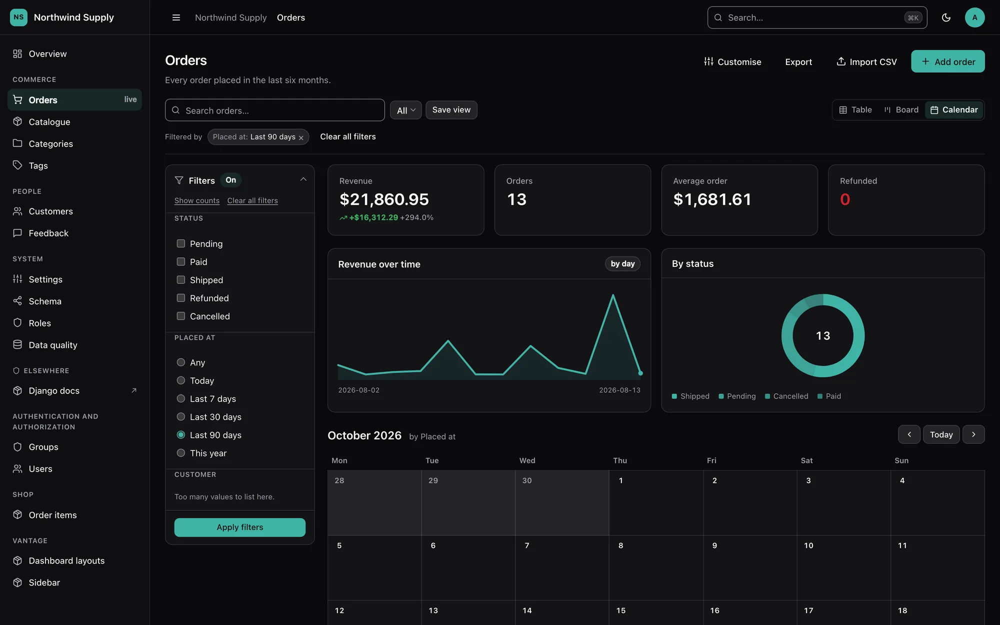
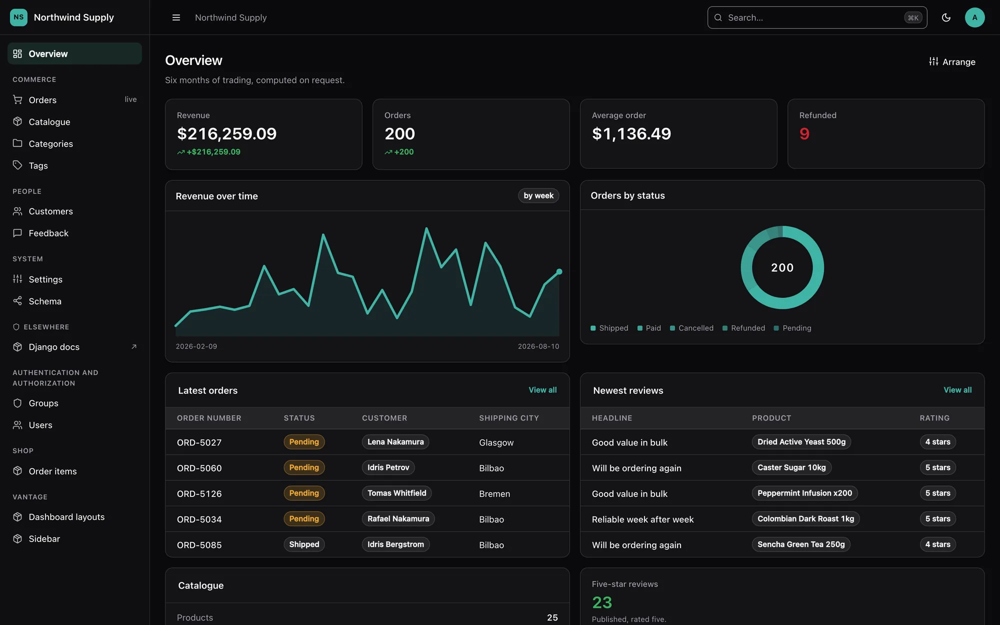
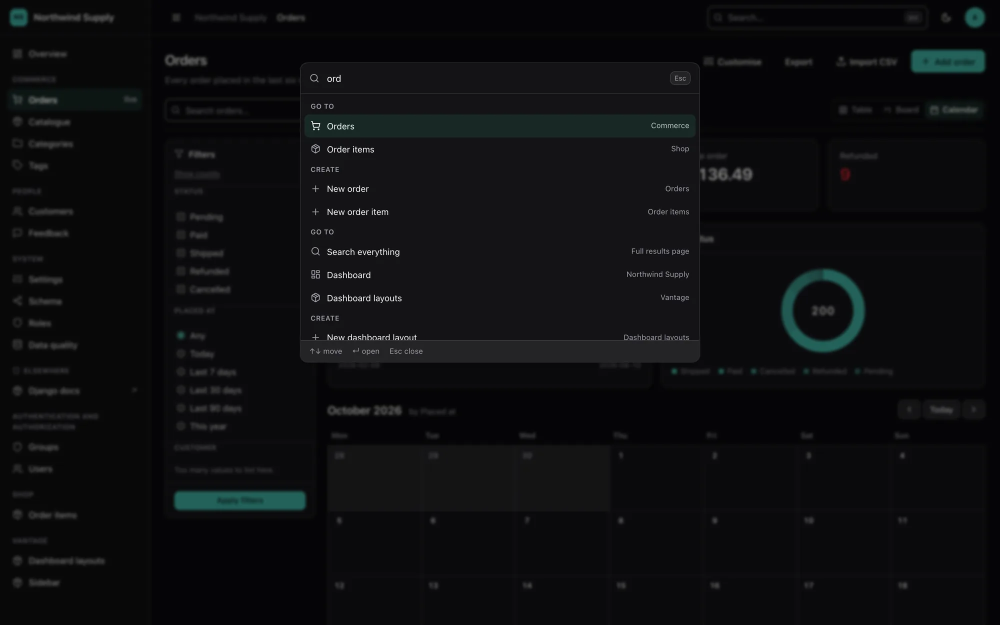
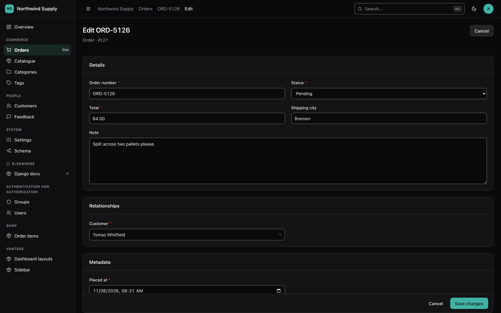
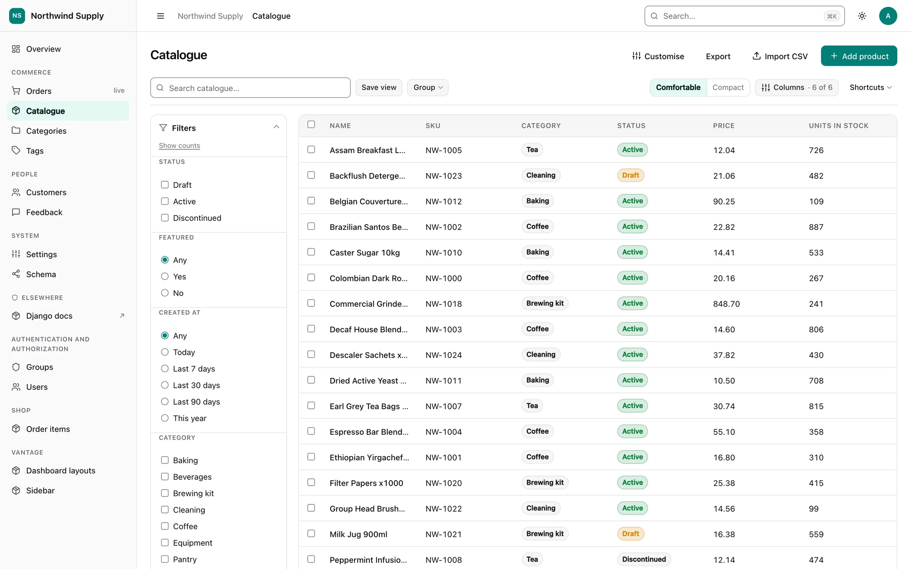
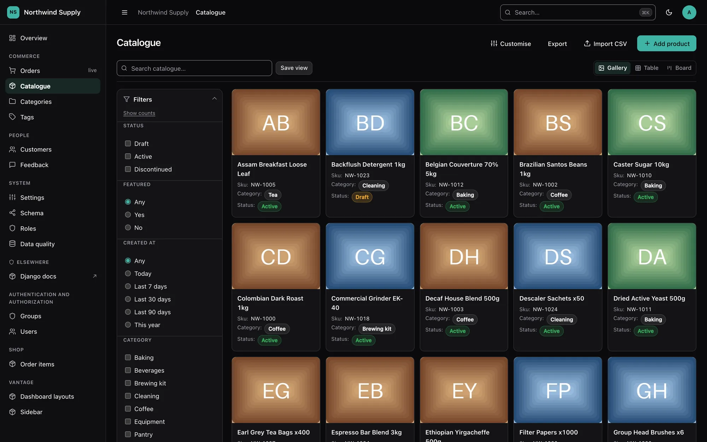
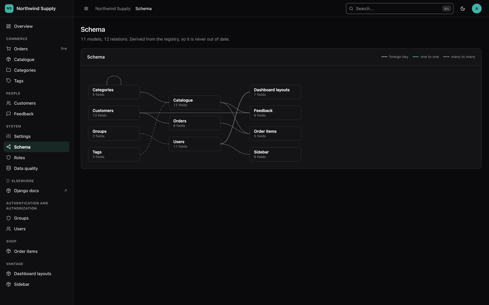

<div class="dv-hero" markdown>

# A smart, beautiful admin panel for Django

<p class="dv-tagline">Zero config to start. One line to override anything.
Install it, and every model you have is already administrable — with a data grid,
charts, a command palette, light and dark themes and a schema map.</p>

[Get started](getting-started.md){ .md-button .md-button--primary }
[View on GitHub](https://github.com/Pythondeveloper6/django-vantage){ .md-button }

</div>

{ .dv-shot .dv-only-light }
{ .dv-shot .dv-only-dark }

!!! warning "Alpha — `0.1.0a1`"

    Working and heavily tested — more than 3,600 tests — but the API may still move.
    See the [FAQ](faq.md#how-finished-is-this) for an honest account of what is and is
    not done. Use it on an internal tool; pin the exact version if you depend on it.

## Sixty seconds

```bash
pip install --pre django-vantage
```

```python
# settings.py
INSTALLED_APPS = ["vantage", ...]
```

```python
# urls.py
from django.urls import path
from vantage import site

urlpatterns = [path("admin/", site.urls)]
```

That is the whole setup. Every model in the project is now administrable.

To change one model, write a `panel.py` next to its `models.py`:

```python
from vantage import ModelPanel, register

from blog.models import Post


@register(Post)
class PostPanel(ModelPanel):
    list_display = ["title", "author", "status", "published_at"]  # (1)!
```

1.  Only the columns change. Filters, search fields and widgets stay inferred —
    partial configuration never opts you out of the rest.

Not sure what was inferred? Ask the package to write it down:

```bash
python manage.py vantage_scaffold blog
```

That prints a real `panel.py` containing exactly what Vantage decided. Own it, edit it,
or delete an attribute to hand it back to inference.
Full walkthrough: [Getting started](getting-started.md).

## What you get

<div class="grid cards" markdown>

-   :material-auto-fix:{ .lg .middle } **Inferred, attribute by attribute**

    ---

    Columns, filters, search, sort order, widgets and query optimisation come from the
    model itself. Override one and the rest stay inferred.

    [:octicons-arrow-right-24: Inference](inference.md)

-   :material-table-large:{ .lg .middle } **A real data grid**

    ---

    Saved views, grouping, density, column picker, inline editing, trash and restore,
    bulk actions that scale to "select all 40,000 matching".

    [:octicons-arrow-right-24: Lists](lists.md)

-   :material-chart-areaspline:{ .lg .middle } **Stats and charts in Python**

    ---

    `Stat` and `Chart` declared on the panel, computed on the filtered rows, folded
    into as few queries as possible. Inline SVG — no JavaScript.

    [:octicons-arrow-right-24: Analytics](analytics.md)

-   :material-form-select:{ .lg .middle } **Forms with a layout DSL**

    ---

    `Tabs`, `Section` and `Row`; editable inlines; a cascade-delete preview that
    shows the real tree of what goes with a record.

    [:octicons-arrow-right-24: Forms](forms.md)

-   :material-shield-lock-outline:{ .lg .middle } **Permissions that hold**

    ---

    Three layers, enforced on every view, bulk action and API call. Read-only mode
    and impersonation live in the permission layer; multi-tenancy is fail-closed.

    [:octicons-arrow-right-24: Permissions](permissions.md)

-   :material-api:{ .lg .middle } **A JSON API for free**

    ---

    Every panel, through the same permission and validation path as the UI, with
    cursor pagination and optimistic concurrency.

    [:octicons-arrow-right-24: The JSON API](api.md)

-   :material-palette-outline:{ .lg .middle } **One colour, a whole theme**

    ---

    A brand colour becomes a complete light and dark palette with contrast checked.
    RTL from day one.

    [:octicons-arrow-right-24: Theming](theming.md)

-   :material-tune-variant:{ .lg .middle } **Configurable from the UI too**

    ---

    Columns, filters, stats, the dashboard, the sidebar and the branding — without a
    deploy, in one fixed order with `panel.py`.

    [:octicons-arrow-right-24: How configuration resolves](configuration.md)

</div>

## A closer look

=== "Dashboard"

    { .dv-shot .dv-only-light }
    { .dv-shot .dv-only-dark }

=== "Command palette"

    { .dv-shot .dv-only-light }
    { .dv-shot .dv-only-dark }

=== "Edit form"

    { .dv-shot .dv-only-light }
    { .dv-shot .dv-only-dark }

=== "Catalogue"

    { .dv-shot .dv-only-light }
    { .dv-shot .dv-only-dark }

=== "Schema map"

    { .dv-shot .dv-only-light }
    { .dv-shot .dv-only-dark }

## The two rules

Everything in this package follows from two rules.

**1. Smart.** Install it, and every model in your project already has a usable admin.
Columns, filters, search fields, sort order, widgets and query optimisation are all
inferred from the model itself. You write no configuration to get something worth
looking at.

**2. Easy.** Every inferred default is overridable in one line, and overriding one
thing overrides only that thing. Setting `list_display` changes the columns; your
filters, search and widgets stay inferred. Partial configuration never opts you out of
the rest of the intelligence.

The second rule is the load-bearing one. A tool where "customise anything" means
"customise everything" gets abandoned the first time someone needs one different
column. Inference is therefore resolved **per attribute**, not as a single
all-or-nothing fallback — see [Inference](inference.md).

**A developer's API is not the only person who has to configure this.** Whatever you
can set in `panel.py` or `VANTAGE`, the person running the panel day to day can often
set from the UI instead — a list's columns and filters, the branding, the behaviour —
without a deploy, and without your Python file becoming a fiction of what actually
renders. The two ways compose in one fixed order, stated once: see
[How configuration resolves](configuration.md).

## Requirements

Python 3.12+ and Django 5.2+ (including 6.x). Django is the only runtime dependency.
No Node.js — the CSS and JavaScript ship prebuilt and depend on nothing.
django-guardian, django-rules, django-mptt, django-treebeard and
django-simple-history are all used when present and never required.

## Map of the documentation

| Page | What is in it |
|---|---|
| [Getting started](getting-started.md) | Install, mount, first look, `vantage_scaffold` |
| [How configuration resolves](configuration.md) | The one order everything composes in: UI override → `panel.py`/`VANTAGE` → inference |
| [Panels](panels.md) | The complete `ModelPanel` surface, attribute by attribute |
| [Inference](inference.md) | Exactly what is inferred and how, including the scoring rules |
| [Lists](lists.md) | Columns, filters, search, sorting, saved views, the per-list customisation rail, trash and restore, bulk actions, background jobs, export and import |
| [Analytics](analytics.md) | `Stat`, `Chart`, the summary bar and the query-cost guarantees |
| [Forms](forms.md) | Widget inference, the layout DSL, editable inlines, readonly fields, validation, delete preview |
| [Permissions](permissions.md) | The three-layer model, bulk row scoping, guardian, read-only, impersonation |
| [The JSON API](api.md) | Read/write endpoints over every panel, cursor pagination, concurrency, errors as data |
| [Multi-tenancy](tenancy.md) | Scoping every registered model to a tenant, fail-closed, over both the panel and the API |
| [Theming](theming.md) | `BRAND_COLOR`, the derived palette, tokens, light/dark, RTL, custom CSS, the settings screen |
| [Internationalization](internationalization.md) | The shipped `en`/`ar` catalogues, activating a language, adding your own locale |
| [Pages and dashboards](pages-and-dashboards.md) | Screens that are not models, dashboard widgets, and arranging cards from the UI |
| [Settings](settings.md) | Every `VANTAGE` key, its default and its effect |
| [Deployment](deployment.md) | What to check before pointing this at production |
| [Security](security.md) | The threat model, the deployment checks, upload screening, rate limiting, CSP |
| [Accessibility](accessibility.md) | What is guaranteed, what you must supply, what is still broken |
| [Browser tests](browser-tests.md) | The Playwright layer over what a test client cannot see: focus, console errors, keyboard behaviour |
| [Extending](extending.md) | Slots, plugins, and adopting an existing `admin.py` |
| [FAQ](faq.md) | How it differs from `django.contrib.admin`, what it does not do |

## Licence and attribution

django-vantage is open source under the
[MIT licence](https://github.com/Pythondeveloper6/django-vantage/blob/main/LICENSE),
copyright © 2026 Mahmoud Ahmed. You may use, modify and redistribute it, commercially
or not, provided the copyright notice and licence text are kept in every copy or
substantial portion of the code. A link back to the project is always appreciated.
