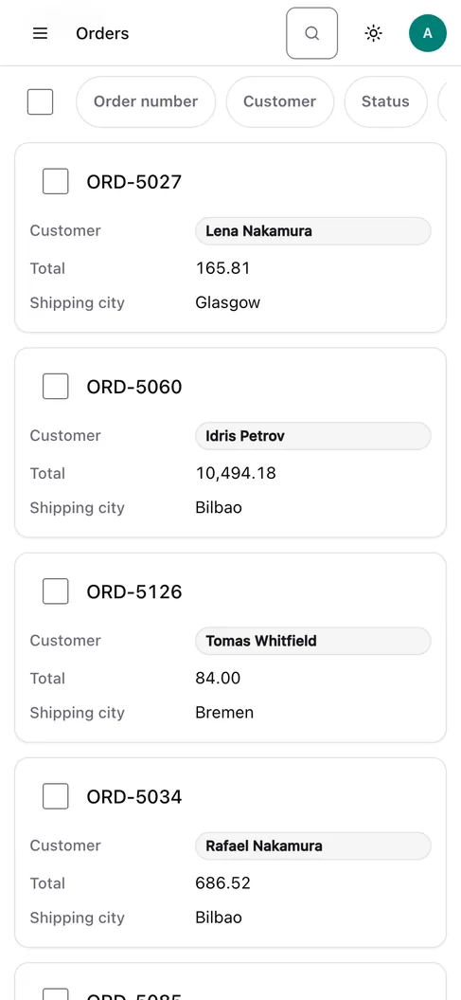
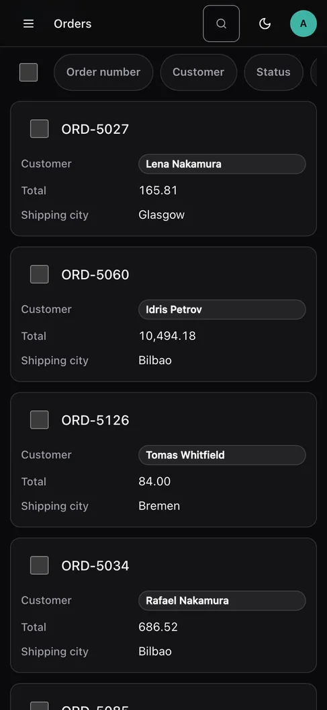
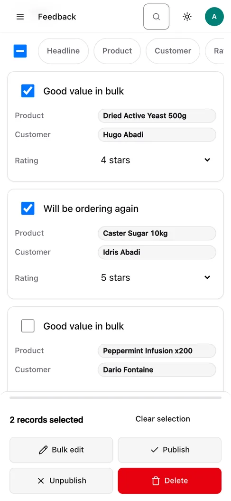
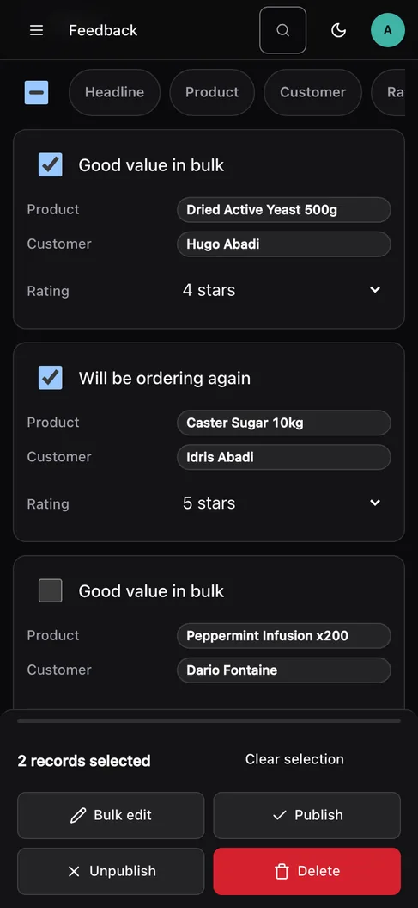

# Phones

Below `40rem` (640px) the panel switches to a phone layout. There is nothing to turn on
and no second template: it is the same markup, restacked by one stylesheet
(`vantage-mobile.css`) that is linked with a media query, so a desktop never loads it
and looks exactly as before.

{ .dv-shot .dv-only-light }
{ .dv-shot .dv-only-dark }

| On a phone | Instead of |
| --- | --- |
| Each row is a **card**: a title, a few label/value pairs, and a checkbox | a table you scroll sideways |
| Bulk actions open in a **bottom sheet** when something is selected | a bar above the table |
| Navigation is a **drawer** behind the menu button | a sidebar |
| The filter rail starts **folded** | an open rail ahead of the first record |
| The header search shrinks to its icon and still opens the palette | a search box |
| Detail and form pages are one column | two |

It follows every UI theme preset and dark mode, because it uses the same colour,
radius and shadow tokens as everything else.

## Which fields a card shows

By default a card shows the first column as its title and the next three as labelled
values. To choose, name the columns in `card_fields` — the same line the gallery and the
board read for the cards under their titles:

```python
@register(Order)
class OrderPanel(ModelPanel):
    list_display = ["number", "status", "customer", "total", "created_at"]
    card_fields = ["total", "status"]     # a phone card: number, then these two
```

The first column is always the title. A name that is not in `list_display` is ignored: a
card is the table's own row restacked, not a second renderer, so it can only show what
the table has. Sorting stays available, as a strip of buttons above the cards.

## The bottom sheet

{ .dv-shot .dv-only-light }
{ .dv-shot .dv-only-dark }

Ticking a card opens the sheet along the bottom edge, with the count, the same actions
as the desktop bar, and **Clear selection**. It is a non-modal dialog, on purpose: the
checkboxes behind it are still being ticked, so focus is neither moved into it when it
opens nor trapped inside it. **Escape** or **Clear selection** closes it, clears the
selection and puts focus back on the last card you touched. The count is announced as it
changes, as on the desktop, and the sheet only carries `role="dialog"` while it is a
sheet.

## Touch targets, zoom and the notch

- Buttons, inputs, selects, the card checkbox and navigation links are at least 44px
  tall.
- Fields are at least 16px, so iOS Safari does not zoom the page when one is focused.
- The page never scrolls sideways. A wide table elsewhere still scrolls inside its own
  box.
- The shell asks for `viewport-fit=cover` and pads the header, content, sheet, save bar
  and toasts by `env(safe-area-inset-*)`, so nothing sits under a notch or the home
  indicator.
- The sheet and the drawer slide in unless `prefers-reduced-motion` is set, in which
  case they appear.

## Limits

- The breakpoint is the width of the screen, not the device. A phone held sideways is
  wider than `40rem` and gets the tablet layout (the table, with the drawer for
  navigation).
- The table's resize, pin and column-visibility controls have no meaning on a card and
  are hidden. The totals strip under the table is hidden too.
- The board, calendar, gallery and map views are unchanged; they already scroll inside
  their own boxes.
- The inline-edit changeset bar keeps its desktop design, wrapped and padded for the safe area.
