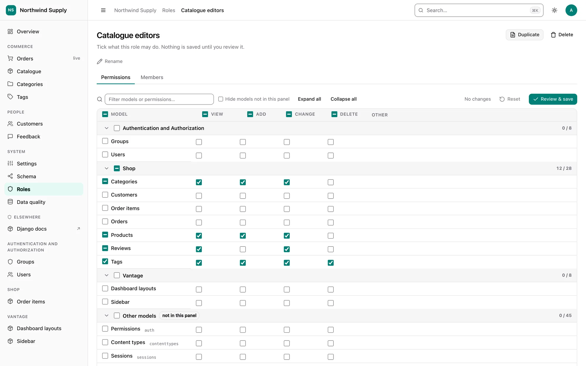
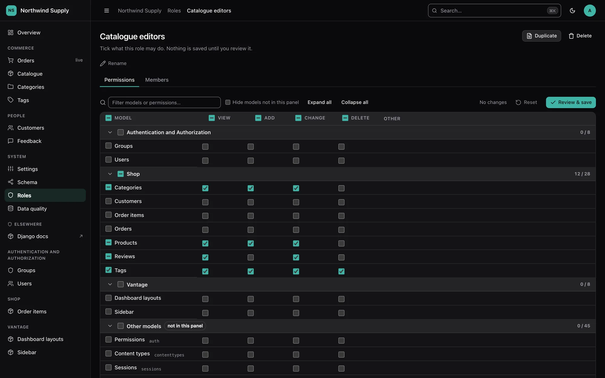

# Roles & permissions

Vantage ships a built-in screen for Django's `auth.Group`, treated as what every project
uses it for: a **role**, a named bundle of permissions you grant to people. It lives at
`<panel>/_/roles/`, appears under **System** in the sidebar and in the ⌘K palette, and
needs no configuration. Model permissions live in the tables `django.contrib.auth`
already has; the one table of Vantage's own holds [field permissions](field-permissions.md).

{ .dv-shot .dv-only-light }
{ .dv-shot .dv-only-dark }

## What it does

- **Roles list** — every role with its member and permission counts. Create, duplicate
  (permissions and field rules are copied, members are not), rename and delete.
- **Permission matrix** — one row per model, grouped by app; columns for the four
  standard verbs (*view*, *add*, *change*, *delete*) plus an **Other** column holding any
  custom permissions (`Meta.permissions`). Tri-state checkboxes toggle a whole row, a
  whole column, a whole app, or everything shown. Sections fold, and a filter box narrows
  rows by model name, app or codename.
- **Field access** — a **Fields** column on every model this panel shows makes single
  fields *hidden* or *read-only* for the role. Changes join the same pending diff and
  review dialog. See [Field permissions](field-permissions.md).
- **Pending diff and review** — the toolbar counts what you have changed (`+12 / −3`) and
  marks each changed cell. *Review & save* opens a dialog listing every grant and revoke;
  confirming sends **one POST** that is applied in one transaction, or not at all.
- **Members** — add people with a searchable picker (the same combobox as every relation
  field) and remove them. Each member links to their **effective permissions**: the union
  of every role and their direct grants, with the source of each permission shown, and
  the fields their roles hide or make read-only.
- **Delete preview** — before a role is deleted, the page says how many people would lose
  access, counted *net* of every other role and direct grant they hold.

Models this panel does not register — framework tables, excluded models, content types
whose model has been removed — are still listed, in a final **Other models** section,
because those permissions are real and a role can hold them. The *Hide models not in this
panel* toggle hides that section; the choice is remembered per browser.

## Who can use it

Superusers only, by default. Widen it with `ROLES_PERMISSION`, which takes a permission
string or a callable receiving the request — the same shape as `SETTINGS_PERMISSION`:

```python
VANTAGE = {
    "ROLES_PERMISSION": "auth.change_group",
    # or: lambda request: request.user.groups.filter(name="IT").exists()
}
```

Getting in is not the same as being able to change things. Each write also asks the
[permission layer](permissions.md) for the matching verb on `auth.Group` — `add` to
create or duplicate, `change` to edit the matrix, rename or change members, `delete` to
delete — so [read-only mode](permissions.md#read-only-mode) turns the screen into a
viewer, exactly as it does every other screen.

To switch the screen off for everyone, `"ROLES_PERMISSION": lambda request: False`: it
leaves the sidebar and the palette, and every route answers 403.

### Nobody can grant what they do not hold

Widening access is safe because of one rule, enforced on the server for every request:
someone who is not a superuser can only **grant or revoke permissions they hold
themselves** (as `user.get_all_permissions()` reports them, through every authentication
backend). The cells they do not hold render locked, and a forged request that names them
is ignored. Field rules follow the same idea: changing one needs the model's `change`
permission and full access to that field, so nobody can unhide a field hidden from them.

The same rule covers the indirect routes to escalation. Adding a member hands that person
the role's whole bundle — so changing a role's members, renaming it, duplicating it or
deleting it requires holding **every** permission the role grants. "Add myself to Admins"
is refused rather than being a one-click escalation that never touched a checkbox.

The screen never shows or edits `is_staff` or `is_superuser`. Only a superuser viewing an
account's effective permissions is told that the account is a superuser.

## Safety properties

- **Every permission id is validated server-side.** Ids are checked against the
  `Permission` table and the actor's reach; unknown, malformed or out-of-reach ids are
  dropped, and the save reports how many were ignored.
- **CSRF on every write** — the views are wrapped in `csrf_protect` themselves, so they
  stay protected even in a project that removed `CsrfViewMiddleware`.
- **Conflicts, not clobbers.** Each page carries a fingerprint of the role's name,
  permission set and field rules. The save compares it *under a write lock* on the group row; if a
  colleague changed the role in the meantime, nothing is saved and the page comes back
  (HTTP 409) showing what they granted and revoked, with your own changes re-applied on
  top for you to review and save again. Rename and delete are checked the same way.
  Membership changes are idempotent additions and removals, so they cannot clobber and
  carry no token.
- **Everything is audited.** Each save writes one [audit log](security.md) entry on the
  role, naming every permission added and removed as `app.codename` and every field rule
  changed as `app.model.field: level`; membership changes
  name the users added and removed; create, rename, duplicate and delete are recorded
  too.

## Performance

The matrix is built from two queries — every `Permission` with its content type, and the
role's permission ids — whatever the number of models — plus one for the role's field
rules. Grouping, verb detection and
"is this model registered here" are worked out in Python against the app registry. The
test suite asserts the page's query count is identical with and without three hundred
extra models. Saving is a constant number of statements however many cells changed.

## Keyboard and screen readers

The matrix is a table of native checkboxes, each named by its permission ("Can change
order"), so Tab and Space work as everywhere else. Arrow keys move between cells like a
spreadsheet (Home/End jump to the ends of a row), section headers are disclosure buttons
with `aria-expanded`, and the tri-state headers expose the *mixed* state. Nothing is
drag-only.

Without JavaScript the page still works: the matrix is a plain form, *Review & save*
submits it directly, and the server works out the diff from the state the page was
rendered with. (A role holding more than Django's `DATA_UPLOAD_MAX_NUMBER_FIELDS`
permissions needs the script, which sends only the changes.)

## Custom user models

Any `AUTH_USER_MODEL` works. Membership is found through the user model's many-to-many to
`Group` (`groups` on `PermissionsMixin`); a user model without one has no members tab, and
the matrix still manages the roles themselves. User search covers whichever of the
username field, email field, `first_name` and `last_name` the model has.
