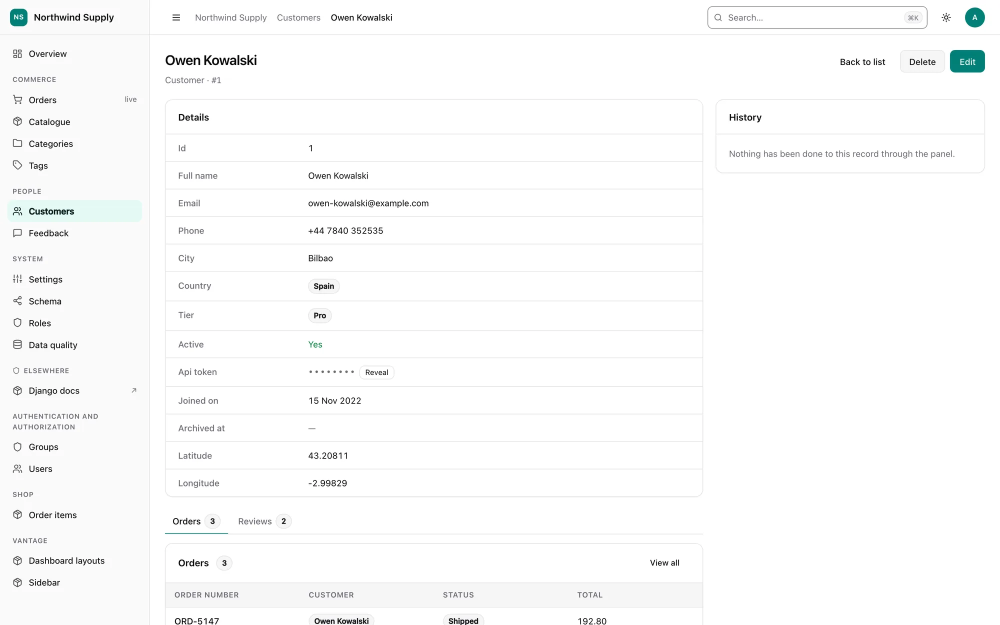
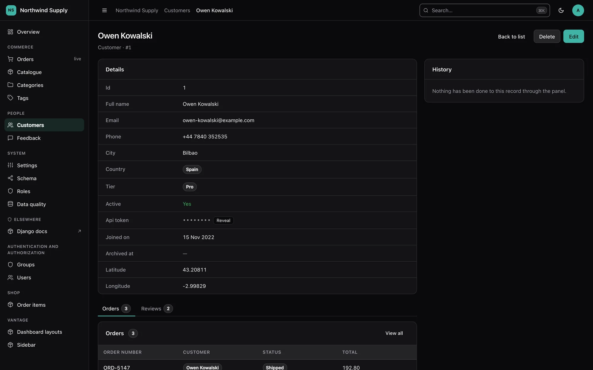

# Sensitive fields

[← Index](index.md)

A field that looks like a secret is treated as one before anybody says so. Its value is
masked on every surface the panel has — list cells, the detail page, exports, the JSON
API, search, the audit log — and a person with the right permission can reveal one
value at a time, which is logged.

{ .dv-shot .dv-only-light }
{ .dv-shot .dv-only-dark }

```python
@register(Customer)
class CustomerPanel(ModelPanel):
    sensitive_fields = ["api_token", "stripe_customer_id"]  # replaces inference
```

That one line is the whole configuration surface for a model. Leave it out and the
fields are inferred; set it to `[]` to switch masking off for that model.

## What is inferred

A field is sensitive when its **name** contains one of the words below as a whole word,
**and** its **type** can actually hold a secret:

```
password  passwd  pwd  passphrase  secret  token  api_key  apikey  access_key
private_key  client_secret  ssn  social_security  tax_id  iban  account_number
card_number  cc_number  credit_card  cvv  cvc  pin  otp  salt  hash  signature
```

"Whole word" means the name is split on underscores (and camelCase), and the word must
be one or more complete parts of it:

| Name | Masked? | Why |
|---|---|---|
| `api_token`, `token`, `stripeApiKey` | yes | contains a whole word from the list |
| `tokenizer_name` | no | `token` is not a whole word here |
| `is_secretary` | no | nor is `secret` |
| `passport_photo_url` | no | personal data, not a credential — nothing in the list matches |
| `token_type`, `pin_attempts`, `password_hint`, `otp_enabled` | no | a trailing `_type`, `_count`, `_attempts`, `_hint`, `_enabled`, `_status`, `_length`… makes it a fact *about* a secret |
| `password_changed_at`, `otp_enabled` | no | a date or a boolean cannot hold a secret |

The types that can hold one are text (`CharField` and its subclasses, `TextField`),
`JSONField`, `BinaryField`, `UUIDField` and numbers. Booleans, dates, relations, files
and anything with `choices` never are.

Two things are sensitive whatever they are called:

- **Encrypted field classes** — any field whose class (or a base class) is named
  `Encrypted…Field`, which covers django-fernet-fields, django-encrypted-model-fields,
  django-cryptography and django-pgcrypto-fields without importing any of them.
- **Django's `User.password`** — always masked, even when a panel's `sensitive_fields`
  leaves it out, and never revealable. There is no screen on which printing a password
  hash is the right answer.

`manage.py vantage_scaffold` writes the inferred list out as `sensitive_fields = [...]`,
so the decision is visible in code review.

### The vocabulary

```python
VANTAGE = {
    "SENSITIVE_PATTERNS": ["...", "nhs_number", "routing_number"],  # extend
    # "SENSITIVE_PATTERNS": ["password", "token"],                  # replace
}
```

A list replaces the built-in words; including `"..."` (or Python's `...`) keeps them.
It is a deployment setting, read straight from `settings.VANTAGE` and deliberately not
editable from the panel's settings screen: a screen that can shorten the list is a
screen that can unmask a column.

## What masking looks like

- `••••••••` — always eight bullets, so the mask's width says nothing about the
  value's length.
- `•••• 4242` for card, IBAN and account numbers (`card_number`, `cc_number`,
  `credit_card`, `iban`, `account_number`), because that is how people tell two cards
  apart — but only when the value has at least ten characters, so four of them are a
  small part of it.
- An **empty** value shows as empty. Whether a customer *has* an API token is the
  useful half of the information, and the half the mask is not protecting.

## Every surface

| Surface | What happens |
|---|---|
| List cells | Masked, with a reveal control. Inference never picks a sensitive field as a column; an explicit `list_display` may, and it renders masked |
| Detail page | Masked, with a reveal control; a password hash gets **Set password** instead |
| Summary bar, stat cards, breakdowns | Never aggregated — a min, max or average is a value, or a bound on one |
| CSV / TSV / JSON export | The same mask as the table; empty stays empty |
| JSON API | `{"value": null, "display": "••••••••", "masked": true}` in lists and records; the schema marks the field `"sensitive": true`; a 409 conflict never shows "theirs" |
| Search, filters, sorting | Never searchable, filterable or sortable — each one is an oracle (see below). Applies to declared configuration too, and `manage.py check` warns (`vantage.W090`) |
| Global search and the ⌘K palette | Never match on a sensitive path, never print one in a result's subtitle |
| Autocomplete | Never searches a sensitive field |
| Inline cell editing | Never offered for a sensitive field |
| Edit form | Write-only (below) |
| Bulk edit | Never offered — one secret on forty rows is forty rows sharing it |
| Duplicate | Not copied; the duplicate page says so |
| Import | The preview masks both sides of a changed secret, a sensitive column is never an upsert key, and the mapping step masks sample values for a sensitive column |
| Audit log and record history | Recorded as "changed — value not recorded", never with the value. Applied again when the log is displayed, so an entry written before a field became sensitive stops printing it |
| Page titles and `__str__` | If a record's `__str__` contains one of its own sensitive values (DRF's `Token` returns the key), titles, breadcrumbs, foreign-key chips, search results, autocomplete, select options and audit labels use `"<Model> #<pk>"` instead |
| Markup | The value is never in an attribute, a `data-` blob or a JSON island — the masked cell carries only the reveal endpoint's URL |

### Why search, filtering and sorting are refused

They do not display the value, but each one answers a question about it:

- **Search** — `?q=sk_live_4f` returning one row says a token starts that way. Repeat
  one character at a time.
- **Filtering** — the row count for `pin = 1234` is a yes/no answer per guess.
- **Sorting** — a page sorted by the masked column, plus one value you know, bisects
  every other one.

So a sensitive path is removed from `list_search`, `list_filter`, `ordering` and
`?sort=` whoever declared it, and `manage.py check` tells you when a declaration was
dropped:

```
vantage.W090: 'search_fields' lists 'api_token', which is a sensitive field on
shop.Customer; it is ignored there.
```

## Revealing a value

A masked value on the list or detail page gets a **Reveal** button for users who may
use it. Clicking it:

1. `POST`s to `<app>/<model>/<pk>/reveal/<field>/` — never a `GET`, which browsers
   prefetch, proxies log and history keeps;
2. fetches the record the way every other view does (scoped by `filter_queryset`, so an
   out-of-reach record is a 404, then checked for `view` at object level);
3. asks the panel's `can_reveal(request, obj, field)` — by default, **superusers and
   holders of `vantage.reveal_sensitive`**;
4. spends one unit of the `reveal` rate limit (30 per 5 minutes per account, enforced
   by the view itself, whether or not the security middleware is installed);
5. writes an audit entry — *"boss revealed api_token on Acme Ltd"* — before the value
   leaves the server;
6. answers `{"value": "...", "expires_in": 30}` with `Cache-Control: no-store`.

The page masks the value again after 30 seconds, when the tab is hidden, and when the
page is left — including into the back/forward cache, whose snapshot would otherwise
keep it.

**Hashes are never revealed**, whatever `can_reveal` says: Django's `User.password`, any
field whose name pairs a hash word with a secret word (`pin_hash`, `api_key_digest`,
`password_hash` — a hashed PIN can be brute-forced in milliseconds), and any value that
turns out to be in Django's `algorithm$…` hash format. A bare `content_hash` is a
checksum, and stays revealable. For a user's password the detail page offers **Set
password**, which uses Django's own `AdminPasswordChangeForm`, needs `change`
permission on that user, and is audited with the value redacted.

### The permission

`vantage.reveal_sensitive` is created by `migrate` (a `post_migrate` handler, so the
feature costs no migration). Grant it like any other permission. To decide per model,
per record or per field instead, override the hook:

```python
class CustomerPanel(ModelPanel):
    def can_reveal(self, request, obj, field_name):
        # Account managers may see their own customers' tokens, and nothing else.
        return obj.account_manager_id == request.user.pk and field_name == "api_token"
```

The hook replaces the default entirely (superusers included), runs only after the
`view` check on the record has passed, and cannot make a hash revealable.

## Write-only form fields

On the edit form a sensitive field is an empty input with a placeholder —
*"Unchanged — type to replace"* when something is stored, *"Not set"* when nothing is:

- **Empty submission keeps the stored value**, so editing a customer's name does not
  wipe their token.
- A **nullable or blank-able** secret gets a **Clear** checkbox, the only way to empty
  it on purpose.
- The stored value is not in the page, not in `form.initial`, and not echoed back after
  a validation error.
- Inputs carry `autocomplete="new-password"`, so a browser's password manager does not
  autofill an admin's own password into a customer's API key field.

The JSON API follows the same rule: an omitted field or `""` keeps the value (a `PUT`
that leaves a secret out keeps it), `null` clears it.

## Threat model

**What this protects against**

- An over-the-shoulder view, a screen share or a screenshot of the panel.
- Staff who need to work with a record but not with its credentials — the default for
  everyone who is not a superuser and has not been granted `vantage.reveal_sensitive`.
- Exports, API responses and audit entries that travel further than the panel does:
  emailed CSVs, client logs, log aggregators.
- Inference attacks through the panel's own controls: search, filters, sorting,
  aggregates, import upsert keys and inline editing.
- Casual bulk extraction through reveal: every reveal is permission-checked, audited
  and rate-limited.

**What it does not protect against**

- **The database.** Values are stored exactly as your models store them. Masking is a
  presentation rule; encryption at rest is a different feature (use an encrypted field
  class — which Vantage then masks automatically).
- **Superusers.** They may reveal by default, and they can grant themselves anything.
  Narrow `can_reveal` if that matters, and watch the audit log.
- **The Django shell, management commands, `dumpdata`, backups** and anything else
  that reads the database without going through the panel.
- **`DEBUG = True` error pages.** Django's technical 500 page prints local variables,
  which can include a model instance and its values. Never run `DEBUG` in production;
  Django's `SafeExceptionReporterFilter` only scrubs settings and request parameters
  whose names it recognises.
- **Your own code.** A panel method column, a custom template, a `slot` contribution,
  a `list_stats`/`list_charts` declaration or a `save_model` hook that reads a sensitive
  field renders whatever it reads. A model `__str__` that embeds a secret in a longer
  string is caught only when the whole value appears in it.
- **Values sent to the browser on purpose.** A revealed value is in the page for up to
  30 seconds, and anything typed into a write-only input is in the request body.
- **Names nobody recognises.** A secret in a column called `notes` is not inferred. Name
  it in `sensitive_fields`, or extend `SENSITIVE_PATTERNS`.
- **Whether a value is set.** An empty secret displays as empty, by design.
- **Who may see it at all.** Masking applies to everyone. To keep a field from one role
  entirely, or to let a role see it without changing it, use
  [field permissions](field-permissions.md).
